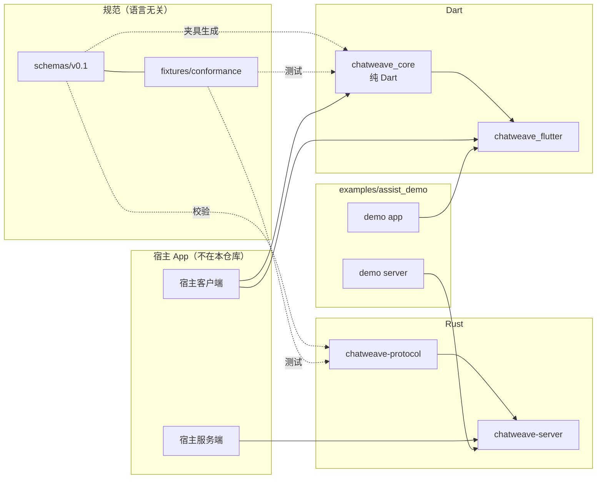
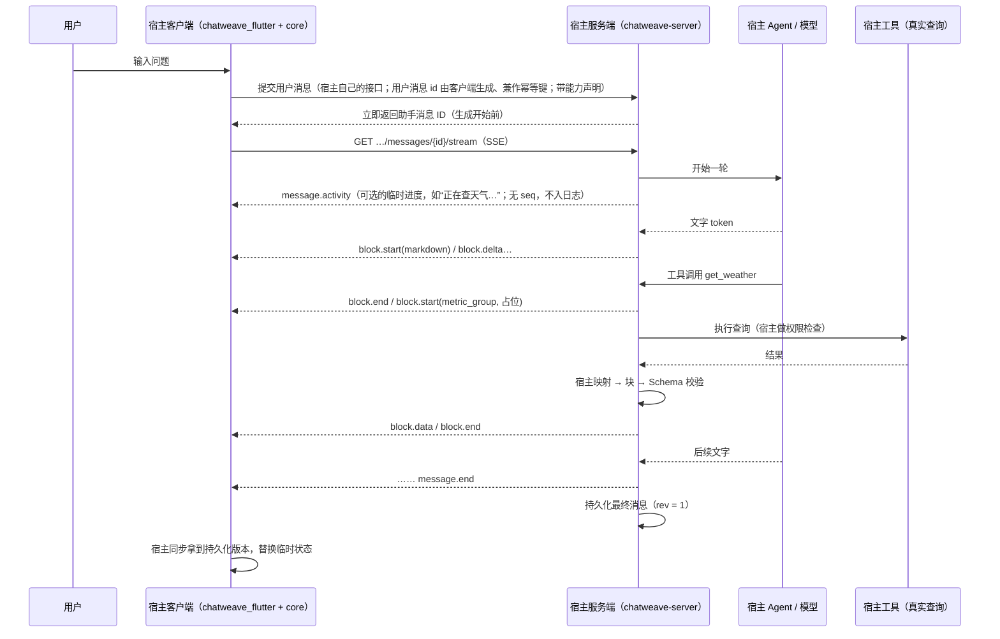
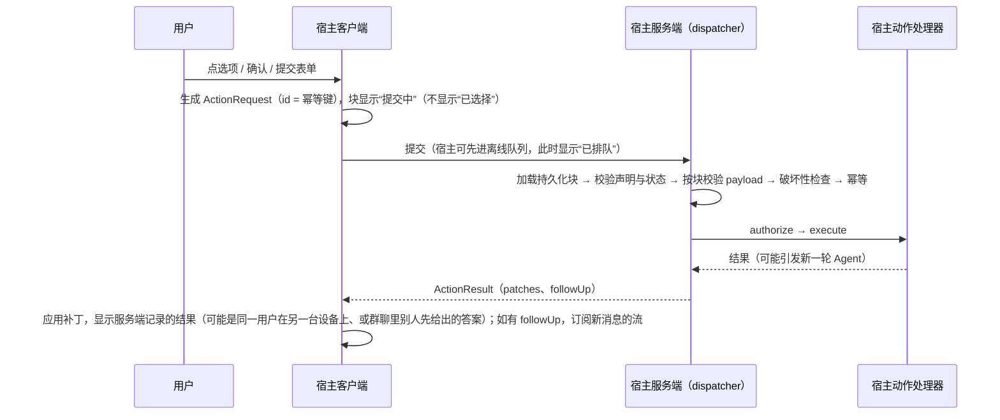

# ChatWeave 架构（草案）

> **状态：草案，设计阶段，尚无代码。** 协议细节见 [protocol.md](protocol.md)，流式细节见 [streaming.md](streaming.md)，渲染见 [rendering.md](rendering.md)。

## 1. 定位

ChatWeave 是一个**Markdown 优先的混合式生成 UI（Generative UI）聊天库**：

- 大多数回答仍是 Markdown，边生成边显示；
- 信息确实适合结构化展示时（指标、数据表、时间序列、比较、状态、选项、确认、表单），Agent 输出**语义数据块**，客户端用原生组件画出来；
- 文字和组件在同一条消息里自然交错，而不是整条消息变成一个网页。

它**不是**“让模型写 HTML / CSS / JS 的系统”，而是一套可控、可校验、与模型无关、对流式友好的“内容协议 + 渲染体系”。

**核心原则：让 Agent 决定表达什么，让渲染器决定通常怎么展示。**

ChatWeave 对宿主业务一无所知：没有“用户 / 租户 / 权限 / 账本”之类的概念。宿主通过接口注入存储、传输、权限检查、业务组件和主题。

### 1.1 适用场景：一对一与群聊

ChatWeave 作为独立的库，两种会话形态都支持（[D38](decisions.md)）：

| 场景 | 说明 | 只在这个场景里出现的问题 |
|---|---|---|
| **一对一** | 一位用户和 AI 对话，没有第三方加入。用户可能有多台设备 | — |
| **群聊** | 多位成员和 AI 在同一个会话里，同一条消息、同一张交互卡会出现在多个人面前 | 多人同时回答同一张卡（先答者胜，[protocol.md 3.4](protocol.md#34-交互块的状态choice--confirmation--form_intent)）；某个块的数据只有部分成员能看（[open-questions.md](open-questions.md) 第 4 条） |

两种场景用同一套协议和客户端规则，库不需要知道当前是哪种。尤其是“交互块点按后只显示‘提交中’，服务端确认后才显示结果”对两种场景都成立：一对一时服务端同样可能拒绝（权限、引用的记录已变化或删除、校验不通过），同一用户也可能在两台设备上操作同一张卡。

## 2. 分层

```
┌──────────────────────────────────────────────────────────────────────┐
│ L1 Agent 运行时（宿主）   模型调用、工具执行、业务推理                     │
│    来源：自研 Agent / 普通 LLM / 外部 Agent（只能输出文本的走降级）        │
├──────────────────────────────────────────────────────────────────────┤
│ L2 内容适配 / 归一化（宿主 + 库辅助）                                    │
│    文本流 → markdown 块；工具结果 / 结构化输出 → 语义块（宿主的映射代码）    │
│    纯文本 Agent → 只生成 markdown，不推断事实                            │
├──────────────────────────────────────────────────────────────────────┤
│ L3 语义内容 IR = ChatWeave Content 协议（库）                            │
│    Message / Block / StreamEvent；Schema 校验、限制检查                  │
├──────────────────────────────────────────────────────────────────────┤
│ L4 UI 编排（库，客户端）                                                │
│    v1：注册表确定性映射（类型 → 组件）、数据校验、默认布局、降级链          │
│    Phase 2：可选 UI Agent 产生受约束的 View 描述（只引用数据）             │
├──────────────────────────────────────────────────────────────────────┤
│ L5 渲染器（库 + 宿主组件，客户端）                                       │
│    Markdown 安全子集、组件注册表、主题接口、流式局部更新、动作派发          │
└──────────────────────────────────────────────────────────────────────┘
```

IR（Intermediate Representation，中间表示）指 Agent 运行时与 UI 之间的那层数据格式：它只描述内容的语义结构，不描述样式。

## 3. 模块与仓库布局

```
chatweave/                         ← 独立公开仓库
├─ schemas/v0.1/                   语言无关的 JSON Schema（规范的机器可读部分）
├─ fixtures/conformance/           一致性夹具：事件流 → 期望的最终消息；Rust 与 Dart 共用
├─ rust/                           Cargo workspace
│  ├─ crates/chatweave-protocol    serde 类型、版本常量、Schema 校验、限制检查、折叠函数（fold）
│  └─ crates/chatweave-server      流生成器（seq / 块 ID / 合并 delta）、EventLog 接口、
│                                  Axum SSE 辅助（feature = "axum"）、Action Registry 与 dispatcher、
│                                  纯文本适配器
├─ dart/                           pub workspace
│  ├─ packages/chatweave_core      纯 Dart：模型、SSE 解码、事件解析、块存储与补丁合并、
│  │                               续传控制、存储接口（宿主实现）、动作传输接口
│  └─ packages/chatweave_flutter   Flutter：聊天列表、输入框、Markdown 渲染、组件注册表、
│                                  中性默认组件、主题接口
├─ examples/assist_demo/           非记账领域示例（天气 + 待办助手）
│  ├─ server/                      Rust + Axum，脚本化的假 Agent（无需模型即可跑）
│  └─ app/                         Flutter App，库的组件测试与 golden 截图都跑在它上面
├─ tool/                           CI 检查脚本（依赖方向、宿主词汇拦截、Schema 与夹具校验）
└─ docs/
```

### 3.1 模块依赖图



依赖方向是硬约束（CI 检查，见第 8 节）：

- `chatweave-protocol` 不依赖任何 Web 框架或异步运行时；`chatweave-server` 的 Axum 支持是可选 feature。
- `chatweave_core` 不依赖 Flutter（可以在纯 Dart 服务端或命令行里用）；`chatweave_flutter` 只依赖 `chatweave_core`、Flutter SDK 和少量渲染依赖。
- 库的任何代码都不引用宿主。

### 3.2 Rust 侧职责

| crate | 提供 | 不提供 |
|---|---|---|
| `chatweave-protocol` | `Message`、`Block`（内置类型的强类型 `data` + 自定义类型的 `serde_json::Value`）、`StreamEvent`、`ActionSpec/Request/Result`；`validate()`（JSON Schema + `Limits`）；`fold(events) -> Message`；自定义类型的 Schema 注册表 | 任何 IO |
| `chatweave-server` | `MessageStream` 生成器：分配 `seq`、块 ID、`index`，合并 delta，开关块，生成 `fallbackText` 辅助；`EventLog` / `EventSink` 接口，默认实现是进程内环形缓冲（[D42](decisions.md)，持久日志由宿主可选实现）；`sse_response()`（Axum，处理 `Last-Event-ID`、心跳、快照回退、`ChatWeave-Protocol` 响应头）；停止生成与“会话中正在生成的消息”查询的辅助函数（D39、D41）；`ActionRegistry` + `dispatch()`；`MarkdownAdapter`（把纯文本流包成 markdown 块） | 持久化实现、鉴权、业务处理器、模型调用 |

Action Registry 的接口草图（未编译，示意）：

```rust
/// Ctx 是宿主的请求上下文（例如“当前用户 + 请求 ID”），库不关心其内容。
#[async_trait::async_trait]
pub trait ActionHandler<Ctx>: Send + Sync {
    fn target(&self) -> &'static str;                 // 例如 "todo.delete"
    fn accepts(&self) -> &'static [ActionType];       // 允许的动作类型
    fn destructive(&self) -> bool { false }           // 破坏性：只接受破坏性确认块的 confirm
    async fn authorize(&self, ctx: &Ctx, action: &ResolvedAction) -> Result<(), ActionError>;
    async fn execute(&self, ctx: &Ctx, action: ResolvedAction) -> Result<ActionOutcome, ActionError>;
}

/// 宿主实现：按 ID 加载持久化的块（同时做作用域校验）、保存块的新状态、保存幂等结果。
#[async_trait::async_trait]
pub trait ActionStore<Ctx>: Send + Sync {
    async fn load_block(&self, ctx: &Ctx, message_id: &str, block_id: &str) -> Result<StoredBlock, ActionError>;
    async fn find_result(&self, ctx: &Ctx, action_id: &str) -> Result<Option<ActionResult>, ActionError>;
    async fn commit(&self, ctx: &Ctx, action: &ActionRequest, outcome: &ActionOutcome) -> Result<ActionResult, ActionError>;
}
```

`dispatch()` 固定执行 [protocol.md 5.2](protocol.md#52-服务端处理顺序库的-dispatcher-固定执行) 的七步；宿主只填“加载、权限、执行、保存”四个点，不能跳过参数校验和破坏性确认检查。

### 3.3 Dart 侧职责

| 包 | 提供 | 宿主要实现 |
|---|---|---|
| `chatweave_core` | 不可变模型类（手写 `fromJson` / `toJson`，**不依赖 build_runner**，减少宿主的依赖负担）；`SseDecoder`（字节流 → SSE 帧，可接任何 HTTP 客户端的字节流）；`EventParser`；`BlockStore`（单一写入口，按 `seq` 去重、按块 ID 合并、`rev` 规则、与持久化版本对账、按消息 `id` 对账乐观用户消息——用户消息 ID 由客户端生成）；`StreamController`（续传状态机、触发时机、退避与上限、“已请求停止”状态、临时进度提示、按会话找回正在生成的消息）；`InteractionController`（交互块的本地显示状态与幂等键）；`ViewportController`（纯函数的滚动状态机）；`inspect()` 只读快照；`Limits` 检查；`MemoryTransport` / `ScriptedTransport` 与宿主实现一致性套件 | `ChatWeaveStore`（持久化消息与续传进度，例如用 drift）、`StreamTransport`（打开 SSE 字节流，例如用 dio）、`ActionTransport`（提交动作，例如走离线队列；可以不提供，此时交互块只读） |
| `chatweave_flutter` | `ChatWeaveList`（消息列表）、`ChatWeaveComposer`（输入框）、`MessageView`、`MarkdownBlockView`（基于 `flutter_markdown_plus` 的受限子集）、`BlockRegistry`（含按块的错误隔离）、默认组件、`ChatWeaveTheme` 主题接口与中性浅色 / 深色默认主题；可选的只读调试面板 `ChatWeaveDebugOverlay` | `ChatWeaveThemeData` 的实现（品牌皮肤）、自定义块组件（例如业务卡片）、可选的用户消息 / 消息外框构建器 |

存储接口草图（示意）：

```dart
abstract interface class ChatWeaveStore {
  Stream<List<Message>> watchConversation(String conversationId);
  Future<Message?> load(String messageId);
  /// 流式中的临时状态与已应用 seq；节流调用。不得覆盖 rev >= 1 的持久化版本。
  Future<void> saveProvisional(Message message, {required int lastSeq});
  /// 来自宿主同步的持久化版本；rev >= 本地 rev 时替换。
  Future<void> saveFinal(Message message);
  Future<int?> lastSeq(String messageId);
  /// 登出或切换用户时调用：清除聊天缓存、临时状态与续传进度。
  Future<void> clear();
}

abstract interface class StreamTransport {
  /// 返回 SSE 响应的原始字节流；afterSeq 为 null 表示从头开始。
  Stream<List<int>> open(String messageId, {int? afterSeq, required ClientCapabilities caps});
  /// 显式停止生成（幂等）。断线、切后台、离开页面都不调用它。
  Future<StopResult> stop(String messageId);
  /// 查询会话里正在生成的消息（App 在拿到消息 ID 之前被杀时用来接回）。
  Future<List<ActiveMessage>> activeMessages(String conversationId);
}

abstract interface class ActionTransport {
  /// 宿主可以先写入本地离线队列再上传；返回结果或“已排队”。
  Future<ActionSubmission> submit(ActionRequest request);
}
```

### 3.4 客户端状态的几条硬规则

- **单一写入口**：`BlockStore` 的所有变化都经过一个 `apply(event)` 入口——流事件、同步下来的持久化版本、动作结果的补丁、本地乐观用户消息，全部翻译成内部事件再进入这个入口。`apply` 同步生效；一次 `apply` 最多通知一次；**没有实际变化就不通知、返回同一个对象**；有变化时只替换受影响的块和消息，其余对象保持原引用（结构共享）。这样 Flutter 侧可以用 `identical` / `==` 跳过重建，也让每一次状态变化都可记录、可回放。
- **交互状态不放在组件里**：交互块的“提交中 / 已排队 / 提示信息”和幂等键由 `InteractionController`（在 `chatweave_core` 里）持有，按 `messageId + blockId` 索引。列表回收、组件重建都不会丢状态，也不会因此生成新的幂等键。
- **只读检查接口**：`inspect()` 返回当前状态的只读快照（每条消息已应用的 `seq`、`rev`、块状态、续传状态与最近的续传记录、进行中的动作、最近 N 个 `apply` 事件的环形缓冲）。它只读，不能触发任何写入或网络请求；调试面板只依赖它（见 [rendering.md 第 8 节](rendering.md#8-调试面板只读)）。

## 4. 数据流

### 4.1 一次带组件的回答



### 4.2 一次交互动作



## 5. 服务端与客户端的职责划分

| 职责 | 服务端 | 客户端 |
|---|---|---|
| 决定“表达什么”（选语义类型、填数据） | ✅ 宿主映射代码（确定性），数据来自工具 / 业务查询 | ✗ |
| Schema 校验与限制检查 | ✅ 严格，发出与持久化前 | ✅ 宽松解析 + 限制检查（防御） |
| 生成 `fallbackText` | ✅ 必须 | 只使用 |
| 决定“怎么展示”（组件、布局、颜色） | ✗ | ✅ 注册表 + 主题 |
| 事件顺序、幂等、持久化 | ✅ `seq`、`rev`、事件日志、最终消息 | ✅ 去重、合并、续传、与持久化版本对账 |
| 动作执行 | ✅ 注册表、校验、权限、确认、幂等、先答者胜 | 只发请求，显示“提交中”；结果以服务端补丁为准 |
| 生成控制 | ✅ 同步返回助手消息 ID、停止生成、查询正在生成的消息 | 用户按停止才发停止请求；断线不等于停止 |
| 权限与作用域 | ✅ 宿主 | ✗ 不信任客户端 |

## 6. 与宿主的集成点

| 集成点 | 宿主做什么 |
|---|---|
| 消息创建接口 | 宿主自己的接口（库不规定）：接收客户端生成的用户消息 ID 和能力声明，**在生成开始前同步返回**助手消息 ID；同一个用户消息 ID 重复提交返回同一个助手消息 ID（D41、D43） |
| 流式端点 | 用 `chatweave-server` 的 SSE 辅助挂到自己的路由，前面加自己的鉴权 |
| 停止 / 活动消息查询 | 用库的辅助函数挂两个端点（[streaming.md 4.4、4.5](streaming.md#44-停止生成)），鉴权同流式端点；谁能停止由宿主决定 |
| 事件日志 / 消息存储 | 实现 `ActionStore` 和消息存储；`EventLog` 默认用库的进程内实现，多实例部署或要求重启后仍能逐事件续传时自己实现（例如 PostgreSQL，D42） |
| 业务结果 → 块 | 宿主的映射函数：工具结果 / 结构化输出 → 内置块或 `x-<host>.*` 自定义块 |
| 自定义块 Schema | 服务端注册 JSON Schema；客户端注册组件 |
| 客户端存储 | 实现 `ChatWeaveStore`（例如 drift），持久化版本由宿主的同步机制写入 |
| 网络 | 实现 `StreamTransport`、`ActionTransport`（用宿主已有的 HTTP 客户端、鉴权、请求 ID、离线队列） |
| 主题 | 实现 `ChatWeaveThemeData`，可选替换某个默认组件 |
| 消息级操作 | 可选：在消息操作栏里加宿主自己的操作（例如点赞 / 点踩反馈），库只提供插槽和回调，这些数据不进协议（D47） |

## 7. 分期

### Phase 1（MVP，协议 0.1）

- Markdown 与结构化组件混排；语义 IR（10 个内置类型 + 自定义类型）。
- 客户端注册表的确定性映射；降级链；Markdown-only 模式。
- 流式：Markdown 增量、组件整块；稳定块 ID、按 ID 补丁、幂等事件、`Last-Event-ID` 续传、快照回退；持久化版本优先；显式停止、临时进度事件、按会话找回正在生成的消息。
- 基础 Schema 校验与限制。
- 最小动作集：`choice.select`、`confirmation.respond`、`form.submit`，服务端注册表 + 参数校验 + 宿主权限 + 破坏性确认。
- 示例 App 与 golden 测试；一致性夹具；宿主实现一致性套件；只读调试面板。
- 一对一与群聊两种场景都覆盖（示例 App 至少用两台模拟设备验证多设备与并发回答）。
- 不做：UI Agent、View 协议、组件字段级流式、图片。

详细任务见 [mvp-plan.md](mvp-plan.md)。

### Phase 2（智能展示规划）

- 实现 View 协议（`message.view`、`view.*` 事件）：组件组合与布局描述，**只能用 `dataRef` 引用块数据**，不能复制或改写事实。
- 可选 UI Agent：只在复杂看板、多图联动、非标准布局时按需调用；输出严格按 Schema 校验；统计调用成本和延迟；失败或超时回退到确定性渲染；不阻塞主 Agent 的文字输出（先渲染已知内容，View 到达后在合适时机替换布局）。
- 可选 A2UI 适配器（见 [protocol.md 第 10 节](protocol.md#10-与-a2ui-的映射意图不依赖)），视 A2UI 成熟度而定。

### Phase 3（交互式 Agent UI）

- 完整 Action 协议：点击指标看详情、点图表数据点、筛选、选择分析对象、触发新一轮 Agent、组件增量更新。
- 组件字段级增量流式（例如表格逐行、图表逐点）。
- 闭环：用户意图 → Agent 执行 → 结构化内容 → 可交互视图 → 用户动作 → Agent 执行。

## 8. 防耦合措施

1. **独立仓库**：库与任何宿主分仓发布，宿主只能通过公开 API 使用。
2. **CI 依赖方向检查**：`tool/check_deps` 检查 `chatweave_core` 的 pubspec 不含 Flutter、源码不导入 `package:flutter`，也不直接使用 `dart:io`、`dart:html` 或平台通道（这些能力只能通过宿主注入的接口获得）；`chatweave-protocol` 的依赖树不含 axum / tokio；示例只能依赖公开 API。
3. **宿主词汇拦截**：`tool/host_terms.txt` 列出不该出现在库代码里的业务词（例如具体宿主名、账本、空间、账户、余额等），CI 在 `rust/`、`dart/packages/`、`schemas/`、`examples/` 中检索，命中即失败。文档里作为例子出现的自定义类型名不在检查范围。
4. **示例领域刻意不同**：示例 App 是天气 + 待办助手，库的组件测试与 golden 都跑在它上面，保证库在“非宿主领域”里完整可用。
5. **宿主上下文泛型化**：服务端用泛型 `Ctx` 传宿主上下文，库里没有“用户 / 租户 / 权限”类型。
6. **开发期本地依赖，发布后版本依赖**：宿主开发时用本地路径依赖（Dart 的 `path:` 或不入库的 `pubspec_overrides.yaml`；Cargo 的 `[patch]`），库发布版本后改为版本依赖。宿主仓库的 CI 必须能在不依赖开发者本机目录的情况下构建（例如固定到库的某个提交）。
7. **宿主实现一致性套件**：`chatweave_core` 附带一套契约测试，宿主把自己的 `ChatWeaveStore`、`StreamTransport`、`ActionTransport` 实现交给它，在宿主自己的仓库里运行。可选能力没实现时跳过并写明原因；一条用例都没跑到算失败（防止“空跑通过”）。库自带的 `MemoryTransport` / `ScriptedTransport` 让组件测试和示例 App 不连服务器也能运行。
